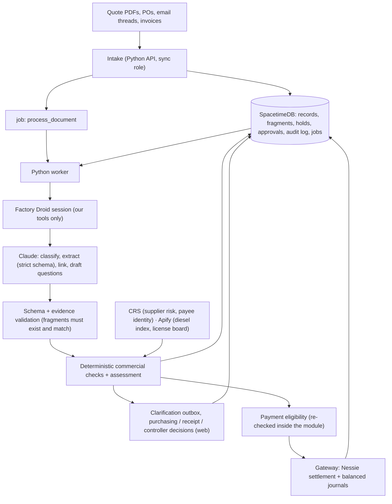

# Architecture

## Flow

Every write goes through a SpacetimeDB reducer that checks the caller's role and logs the result, including refusals. The web app subscribes to the same tables, so every screen updates live. Judges' phones only talk to the web app and SpacetimeDB.

## Claude vs. application code

**Claude handles interpretation:** reading quotes and supplier conditions; understanding email discussions; identifying possible amendments; connecting differently worded invoice and PO items; drafting clarification questions; explaining findings with evidence.

**Application code handles financial controls:** arithmetic and rounding; purchasing limits; approval permissions; duplicate detection; deposit allocation; payment eligibility; accounting entries; preventing repeated payments.

**Citations vs. structured output:** the Claude API returns an error if citations are enabled together with strict JSON schema output. So extraction uses strict schemas (`output_config.format` or `strict: true` tools) with our own fragment IDs that we validate, and the citation-enabled "why?" explanation is a separate call that can't change amounts or approvals.

## Adapting the spec to our stack

The detailed spec ([BUILDBUY_PROMPT.md](BUILDBUY_PROMPT.md)) was written for PostgreSQL. Each requirement maps onto what we already run:

| The spec asks for | On our stack |
|---|---|
| PostgreSQL + SQLAlchemy + migrations | SpacetimeDB tables; schema changes = republish the module |
| Transactions and constraints | Each reducer is atomic; rules live inside reducers |
| Authenticated identities, never trust a client role | One SpacetimeDB identity per role; the module checks it on every call |
| Durable jobs with leases, retries, restart recovery | `job` table with claim/finish, plus `attempts`, `next_attempt_at`, `lease_expires_at` (CONTRACT §9) |
| Append-only audit history | `audit_log`, including denied attempts, written in the same reducer |
| Idempotency keys | `request_id` on every reducer; gateway checks for an existing transfer before sending |
| Version-bound approvals that go stale | `payment_approval` stores revision, amount, deposit allocation, payee profile, assessment fingerprint, policy version; module marks it stale on any change |
| FastAPI backend | Kept for upload, email intake and file preview only; everything else is the job bus |
| Simulated payment adapter | Nessie sandbox via the gateway |
| Claude tools (get_invoice_bundle, get_term_version, list_open_holds…) | Factory Droid tools, with Droid's built-in file and shell tools removed (`restrict_tools`) |
