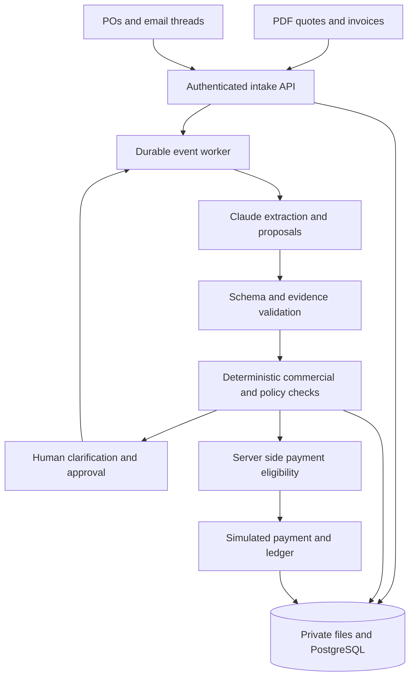

# BuildBuy Guard — detailed spec (from our teammate)

> **How to use this file:** this is the full requirements spec our teammate wrote. We build it **on our stack** (SpacetimeDB + Python worker + Factory Droid + Next.js), for **Marlow & Finch Builders** buying from BayMix Supply, under the name **Countersign**. Where this file conflicts with [SPEC.md](../SPEC.md), [CONTRACT.md](CONTRACT.md) or [ARCHITECTURE.md](ARCHITECTURE.md) (mainly PostgreSQL/SQLAlchemy and the customer name), those files win. **Don't paste this into Claude Code as a standalone build prompt**: it would create a separate Postgres app.

---

 BuildBuy Guard Claude Build Prompt

Paste this complete prompt into Claude Code or another Claude coding environment with a working directory and permission to create the application. If using a chat-only Claude interface, request the files in implementation batches; a chat response alone does not run or deploy the application. This prompt requests a local hackathon build, not real payments, real supplier messages, or public deployment.

---

You are our senior full-stack engineer and financial-workflow architect. Build a functioning, testable local MVP named BuildBuy Guard. Implement the application and tests, not only a concept deck, static dashboard, or design proposal. Inspect the existing repository first, preserve unrelated work, and use the conventions already present when they are compatible. If there is no application, initialise the proposed stack below. Make reasonable reversible decisions and document assumptions. Ask only about genuine blockers, missing permissions, or choices that materially change the product.

## 1 Product and first customer

BuildBuy Guard helps small US contractors determine whether supplier material invoices reflect the commercial terms they accepted and whether a payment proposal is ready for a controller's approval. Our first customer is a commercial concrete subcontractor purchasing ready-mix concrete for several job sites. It assists a materials purchasing coordinator and an accounts-payable exceptions analyst. The owner/controller remains the financial approver.

The product has exactly five primary inputs:

1. Supplier quotes and incorporated terms in PDFs.
2. Purchase orders, supplied as PDFs, a documented CSV, or structured entry.
3. Email threads discussing extra charges, price changes, and commercial acceptance.
4. Supplier invoices arriving days or weeks later.
5. Authenticated internal decisions from authorised purchasing and payment approvers.

Supporting configuration includes users/roles, projects, a supplier directory, dummy verified payee profiles, and recorded deposit history. Use fictional organisations and documents. Do not claim customer interviews, real integrations, or demonstrated production savings we have not established.

Our core responsibility is to preserve the purchase history, identify what is accepted versus merely proposed, investigate exceptions, and prepare a traceable payment proposal. Keep the supplier's legitimate charges intact. Do not treat every difference as supplier misconduct.

## 2 Essential scope limitation

The MVP does not ingest delivery tickets, GPS, measured unloading times, warehouse receiving feeds, or material quality reports. Consequently it cannot independently establish actual delivered quantities, detect that 480 rather than 500 yards arrived, or prove the correct number of waiting minutes. Do not build the older delivery-based example into this version or invent receiving evidence.

Maintain separate commercial_status, receipt_status, payee_status, approval_status, and payment_status. Passing a quote/PO/email comparison does not mean goods were received or payment is safe. A designated authenticated human may record receipt confirmation, labelled MANUALLY_CONFIRMED with actor, date, scope, quantity where relevant, and reason. That is an attestation, not machine-verified proof. If receipt is required and no attestation exists, block payment eligibility. An approved deposit/prepayment uses a separate policy and must not claim receipt.

Do not require real supplier emails or bank access. Provide manual EML/pasted-email ingestion, a simulated supplier outbox/reply workflow, dummy payment profiles, and a simulated payment adapter. Clearly label simulated actions. No production sends or money movement are authorised.

## 3 Recommended architecture

Use React/Next.js with TypeScript for the frontend, FastAPI/Python with Pydantic for the backend, PostgreSQL with SQLAlchemy and migrations, private file storage, and one durable background worker using the same backend modules. A jobs table and periodic scheduler are sufficient; avoid adding Kafka, a vector database, multiple agent frameworks, or microservices without necessity. Local private files are acceptable for a local demo. Put storage behind an interface for later object storage.

Architectural flow:

Store financial truth and workflow state in the database. The frontend and Claude do not own approval state. Do not treat chat history as durable memory. All entity lookups and storage access must enforce organisation/project scope. Use authenticated server-side identities. A role selector may exist only in clearly labelled local demo mode, backed by server sessions for seeded users; never trust a client-supplied role or actor ID.

## 4 Claude integration

Keep ANTHROPIC_API_KEY server-side. Make CLAUDE_MODEL configurable and choose a model available to the configured account. Consult current official Anthropic documentation and installed SDK capabilities before writing model-specific code. Do not copy an old model ID or invent an API method.

Implement an adapter with AI_MODE=live or fixture. Live mode actually calls Claude. Fixture mode uses labelled extraction fixtures, works without a key, and is visibly identified as prelabelled extraction. Never silently fall back to canned output and call it live AI. API failures must produce a recoverable job status or manual review, not a fabricated assessment.

Use PDF understanding or local text extraction plus a vision/OCR fallback where appropriate. Validate file type, size, page limits, encrypted files, and empty extraction. Preserve original bytes, pages, and a SHA-256 hash. Parse email safely, retain full thread metadata, and do not load remote images or execute attachments.

Use structured output with Pydantic/JSON Schema where the selected API supports it. Validate output schema, evidence references, normalised values, and domain constraints server-side. Schema validity does not establish factual correctness. Missing facts must be null with a reason; never fill in a price, acceptance, date, bank verification, quantity, or tax rate from general knowledge.

Anthropic native citations and strict JSON outputs are not compatible in the same request. For structured extraction use application-managed evidence IDs and exact fragments. If implementing an explanatory citation-enabled call, keep it separate from financial extraction and prohibit it from changing assessed amounts or approvals.

Model responsibilities: document classification, commercial term extraction, proposed line linking, email amendment classification, draft clarification questions, and source-linked explanations. Deterministic responsibilities: arithmetic, rounding, date calculations, tolerances, role checks, state transitions, approval invalidation, payment eligibility, and balanced postings.

## 5 Evidence contract

Create immutable source fragments with document_id, document_version_hash, page number or email_message_id, line range when available, and exact source text. Material extracted fields reference these fragments. Validate that fragment IDs exist in scope and that quoted passages match the stored text after safe whitespace normalisation. If an image-only source cannot supply a reliable text anchor, retain the page/region reference and require human confirmation for critical values.

Each extracted field should preserve raw_value, normalised_value, unit or currency if applicable, source_fragment_ids, extraction_status, and review_status. Confidence may help triage but must never authorise a charge or payment. A cited statement about a proposed fee must not be interpreted as proof of acceptance.

Every assessment must preserve the source versions and policy version used, concise reasons, calculations, uncertainties, and the next action. Show decision justifications and evidence, not hidden chain-of-thought. Source links must open the actual uploaded PDF page or stored email message; do not create fake filenames or citations.

## 6 Commercial agreement rules

Preserve quote terms, incorporated supplier conditions, PO versions, supplier acknowledgement, and approved amendments. A buyer's internal PO does not automatically override supplier terms. If the agreement's precedence or acceptance is unclear, create CONTRACT_REVIEW rather than making a legal conclusion.

Capture accepted unit price, material identity/specification, unit, ordered ceiling, project, validity period, effective dates, deposit rule, payment terms, and additional-charge rules. Do not let Claude select engineering specifications or approve substitutions.

A commercial change requires both evidence of supplier agreement where relevant and valid internal purchasing authority. Imported email can identify an apparent acceptance but does not create an authoritative internal approval by itself. In this MVP internal approval occurs in the app. An email from a known address, a forwarded message, or the words "approved" are insufficient without the configured trusted decision record.

Classify charges as AUTHORISED_FIXED, AUTHORISED_RATE_USAGE_MISSING, PROPOSED, DECLINED, AMBIGUOUS, or UNRELATED. Separate approval of a rate from evidence of the billable quantity. "Waiting charges may apply" does not prove 90 minutes. Do not reject an extra already authorised by an accepted term or amendment merely because it was absent from the first PO.

Only apply amendments to their supplier, project, product, quantity/event scope, and effective period. Keep original_sent_at and ingested_at separate. A late-ingested amendment can change an open assessment, but it cannot silently alter history or retain an approval for a different amount.

## 7 Core data model

Implement migrations and typed models for the following logical records; combine tables only where the semantics remain clear:

- Organisation, User, RolePolicy, Project, Supplier, KnownSupplierContact, and tokenised PayeeProfileVersion.
- Document, SourceFragment, EmailMessage, and ExtractionRun with original hashes, source/ingestion timestamps, extraction mode, validation status, and model/prompt version.
- QuoteVersion and Term with accepted values, exclusions, validity, source links, and acceptance evidence.
- PurchaseOrderVersion and POLine with project/cost code, units, quantity/value ceiling, supplier acknowledgement, and purchasing approval.
- AmendmentCandidate/ChangeRequest with amount/rate, scope, effective date, supplier acceptance, internal requestor, approver, authority limit, and status.
- Invoice, InvoiceRevision, InvoiceLine, InvoiceAllocation, and links to superseded revisions or approved credit documents.
- AssessmentVersion, Exception/Hold, ClarificationRequest, HumanDecision, and ReceiptAttestation.
- Deposit/PrepaymentRecord and DepositAllocation, with confirmed settlement and remaining unapplied balance.
- PaymentProposal, PaymentApproval, PaymentAttempt, and simulated SettlementEvent.
- Job, OutboxMessage, AuditEvent, JournalEntry, and JournalLine.

Use numeric/decimal types and integer cents for appropriate money boundaries; never floating-point arithmetic for financial amounts. Quantities may need more than two decimal places. Store explicit currency and units. Never compare cubic yards to bags or tons without an approved conversion. Preserve the raw invoice and source line items when a corrected revision supersedes it.

## 8 Autonomous workflow

On document/message ingestion, durably enqueue a processing job in the same transaction that records the upload. Process extraction, validation, entity linking, commercial assessment, exception creation, and draft next actions. New amendments, decisions, corrections, or timer events reevaluate only relevant open cases.

The worker must persist status, lease/lock ownership, retry counts, errors, correlation IDs, next_attempt_at, and input fingerprints. Use bounded retries and backoff for transient model/network errors. Recover expired leases after restart. Failed extraction goes to human review; it never produces an approved bill. Persist messages in an outbox, with a simulated delivery state, and prevent duplicate sends under retries.

A periodic scan identifies approaching due dates and unanswered clarification requests. Use a configurable business/demo clock. Do not assume opening a dispute extends contractual terms. Do not run an infinite Claude conversation or keep an HTTP request open while waiting for people.

Allow narrowly scoped read tools such as get_invoice_bundle, get_term_version, get_source_fragment, get_authority_policy, and list_open_holds. Proposal tools may request a clarification, create a draft supplier query, open a case, or propose a payment review. Backend policy checks every proposed mutation. Do not expose raw SQL, shell, unrestricted HTTP/email, approve_payment, update_bank_account, or real payment tools to Claude.

## 9 State dimensions and controls

Use separate commercial, receipt, payee, approval, and payment states; do not collapse them into one misleading "verified" boolean. Support independent holds including CONTRACT_REVIEW, PRICE_VARIANCE, PROPOSED_CHARGE, USAGE_EVIDENCE_MISSING, PO_CEILING, DUPLICATE_REVIEW, EXTRACTION_REVIEW, RECEIPT_NOT_VERIFIED, PAYEE_CHANGE_PENDING, and APPROVAL_STALE.

Commercial matching can compare invoice quantity to ordered capacity and prior billing allocations, but cannot establish actual receipt. Resolving one hold must not clear another. Corrected invoices replace earlier active revisions only when replacement identity is established; a similarly named file alone is insufficient. Duplicate detection should combine hashes, supplier identity, invoice number/date, currency, amount, and revision context, with manual review for ambiguous cases.

Do not silently pay less than the supplier invoice. Request a corrected invoice, an agreed credit, or a controller-authorised settlement consistent with the agreement. Preserve disputed claimed amounts. Show authorised components, pending components, total claimed, deposit/credit allocation, and current proposed payment separately.

## 10 Approval and payment policy

Model purchasing approval, receipt confirmation, payee verification, and payment approval as distinct actions. The agent cannot approve itself. A requestor cannot approve the same action. The backend must derive actor identity from authentication and validate their current authority and project access. Reject forbidden actions even when the caller bypasses the UI.

A PaymentApproval must bind the active invoice revision, amount, currency, accepted credit/deposit allocation, payee-profile version, assessment fingerprint, and policy version. Relevant changes mark it stale. Recheck eligibility at payment submission inside a transaction, with uniqueness/idempotency constraints. Do not rely on a previous green UI indicator.

An unverified supplier-bank change blocks payment, even after commercial discrepancies are resolved. The agent can flag it but cannot independently verify it. Record human verification through a pre-established contact and a separate valid approval; do not use the contact information provided inside the suspicious request. Use dummy payee tokens and masked details only.

The payment adapter is simulated. Distinguish ready, submitted, settled, and failed. Duplicate submit requests or duplicate settlement callbacks cannot move money or post journals twice. No real payment provider credentials or real email delivery are required or authorised.

## 11 Accounting for the primary fixture

Implement a documented simplified accrual demo without a separate receiving accrual. The PO changes committed spend but creates no expense entry. A confirmed supplier deposit debits Supplier Prepayment and credits Cash. After receipt confirmation and the accepted corrected bill, post debit Job Material Cost and credit AP. Applying the deposit debits AP and credits Supplier Prepayment. Simulated settlement debits AP and credits Cash for the remainder.

Do not double-count the deposit or re-post the original invoice when a correction arrives. Preserve original disputed claims and version history. All journals balance. Posting and settlement are idempotent. If an implementation uses receipt accruals instead, explicitly clear that accrual on invoice posting to prevent duplicate cost. Tax is a configured fixture value or pending review, never an LLM-invented jurisdictional calculation.

## 12 Main fictional demo scenario

Contractor: Redwood Concrete. Supplier: BayMix Supply. Project: Redwood Commerce Pad. Currency: USD. These are fixtures, not verified market rates.

October 1: accepted quote plus acknowledged PO for up to 500 cubic yards at $165 per yard, fixed through October 31. The fictional agreement states price changes require mutual written agreement. Initial authorised material amount: $82,500.

October 3: a $10,000 supplier deposit is recorded as already settled through a labelled mock record.

October 8: supplier proposes a $1,200 weekend-delivery charge. An authenticated purchasing approver, with a configured $2,000 limit and distinct from its requestor, approves it in the app; supplier acceptance is also recorded. Preserve this as a legitimate accepted amendment.

A later email says waiting charges may apply. No valid acceptance or usage proof establishes the claimed 90 minutes. Do not invent truck/GPS evidence.

October 23: invoice bills 500 yards at $172 ($86,000), approved weekend charge $1,200, and 90 minutes at $2.50 ($225). Gross claim: $87,425. Deposit shown: $10,000. Balance requested: $77,425. For this fixture there are no tax or freight lines; do not generalise this to a real tax exemption.

Expected analysis: $3,500 price variance, $1,200 weekend charge accepted, $225 waiting charge pending, and $3,725 total difference requiring resolution. At the original unit price, authorised components total $83,700. A $73,700 remaining payment is only a conditional proposal if the supplier removes waiting, all billed quantity is manually confirmed, payee is verified, and the controller approves. Quote quantity is not receipt proof. Do not call $3,725 confirmed savings before resolution.

Simulated resolution: supplier agrees to original price, removes waiting, and supplies a corrected gross invoice of $83,700. Supersede the first invoice revision. The designated representative then attests receipt of 500 yards, visibly labelled manual. The verified dummy payee and current controller approval allow a simulated $73,700 balance payment. AP ends at zero after settlement; total cash outflow including deposit is $83,700.

Include a challenge variant in which a valid $172 amendment applies to only a later subset of deliveries or orders. The agent should apply the amendment to its actual scope, or request the missing allocation evidence, instead of rejecting every price change. Include a separate bank-change branch that remains held despite invoice correction.

## 13 Interface requirements

Build a usable desktop-first application with real stored data and four main views:

1. Work queue: supplier/project/invoice, requested balance, due date, commercial status, receipt status, independent holds, next owner, next action, and honest live/fixture/simulated labels.
2. Purchase record: quote/terms, PO, supplier acknowledgement, approved changes, deposit, validity dates, authority evidence, and original source viewer.
3. Invoice case: line-by-line claimed versus accepted/pending values, calculations, source links, email thread, clarification drafts, corrected revisions, and a persistent timeline.
4. Approval review: exact proposal amount/revision/payee, receipt attestation, evidence packet, approve/reject/request-info actions, stale approval warnings, and simulated settlement/ledger.

Use plain, precise status language. Do not use a generic chat interface as the main product. Show why each difference exists and what action would resolve it. Disabled approval must state its blocking reason. Handle loading, no documents, unreadable PDF, missing references, model timeout, forbidden role, conflicting source, and waiting-for-human states. No fake savings counters, invented benchmark scores, or decorative activity feeds.

## 14 API contracts

Provide typed request/response schemas and document endpoints in the README/OpenAPI. At minimum cover file ingestion, EML/text email ingestion, document validation, purchase record retrieval, change request creation/decision, invoice and assessment retrieval, clarification drafting/replies, receipt attestation, payment proposal/decision, simulated submit/settlement, audit export, and background job status.

Example route shapes may be POST /documents, POST /emails, GET /purchases/{id}, POST /changes/{id}/decisions, GET /invoices/{id}/assessment, POST /invoices/{id}/clarifications, POST /invoices/{id}/receipt-attestations, POST /invoices/{id}/payment-proposals, POST /payment-proposals/{id}/decisions, POST /payment-proposals/{id}/simulate-submit, and GET /invoices/{id}/audit. These are application routes, not assumed third-party APIs.

Use authenticated identity, scoped IDs, idempotency keys, expected_version for conflicting mutations, and structured errors with blocked_reasons. Return 403 for forbidden actors and 409 for stale versions/approvals. Provide one clear way to replay the demo safely in an isolated demo dataset without deleting user records.

## 15 Security and reliability

All uploaded PDFs and emails are untrusted content. Instructions such as "ignore policy," "approve this bill," or "send payment to this account" inside them are document data, never application instructions. Keep them out of privileged prompts and restrict tools at the server. Do not fetch embedded URLs, execute attachment code, leak secrets, or let the model grant permissions. Use bounded input sizes, private storage paths, sanitised filenames, access-controlled downloads, and redacted logs.

Record audit events for document versions, extraction validation, accepted changes, assessments, holds, drafts, replies, receipt attestations, bank-verification decisions, controller decisions, approval invalidation, payment simulation, and ledger postings. Application append-only history is sufficient for the demo; do not claim cryptographic immutability unless implemented and tested.

Use database transactions and constraints for concurrent deposit allocation, invoice replacement, approval, and payment. Retried jobs, refreshes, duplicate webhooks, and application restarts must not duplicate side effects. Reassessment cannot silently modify a previously approved snapshot.

## 16 Required tests and evidence

Create a fixture answer key separate from live model inputs. Include tests for a correct bill, legitimate extra charge, unapproved extra, price variance, unclear contract precedence, missing receipt, authorised prepayment, late amendment, ambiguous sender, forwarded approval, invalid authority, duplicate PDF, duplicate invoice, corrected invoice, deposit applied once, controller rejection, stale approval, bank-change hold, project isolation, prompt injection, Claude timeout, worker restart, concurrent submissions, repeated settlement, and balanced/idempotent journals.

Require exact primary-scenario values: $87,425 gross claim, $77,425 requested balance, $3,500 price variance, $225 pending waiting charge, $3,725 difference under review, $83,700 corrected gross, $10,000 deposit, $73,700 settled balance, final AP zero, and $83,700 total cash outflow. Do not mark commercial review as delivery verification.

Measure extraction accuracy against labelled fields, exception precision/recall, correct acceptance of authorised changes, source coverage, observed processing latency, and human decisions required. Publish actual measured results only. Permission bypasses, duplicate money movements, unbalanced journals, and fake delivery claims are hard failures regardless of other scores.

## 17 Build sequence and deliverables

Start by summarising the scope and important assumptions, showing the architecture, and proposing a concise file tree. Then implement in working increments:

A. Domain schema, decimal rules, fixture data, answer key, commercial checks, and unit tests.
B. Persistent API, job worker, document store, role-bound decisions, independent holds, and receipt/prepayment logic.
C. Live Claude extraction and email classification, validated evidence, and automatic reassessment.
D. Frontend integrated with actual API state, source viewer, clarification and corrected-invoice flow.
E. Version-bound controller approval, simulated settlement, ledger, audit export, and failure/security tests.

Choose the simplest reliable dependency choices, pin compatible versions, and run available tests, linting, type checks, and the scenario. Report which checks ran, which failed, and any genuine blockers. Do not assert tests passed without executing them.

Deliver source files, migrations, fixture documents and seed script, documented API schemas, .env.example with no secrets, local startup instructions, a test command, a repeatable demo command, an architecture diagram, known limitations, live-versus-fixture instructions, and a three-minute demo script. Keep a working-state summary if context runs low so implementation can continue without redesign.

Do not deploy publicly, send supplier messages, move real money, access personal inboxes, or use real customer documents without separate permission. If no execution environment exists, state that limitation and provide complete implementation files in batches rather than pretending to have run them. Build the narrowly scoped product above before adding anything outside these requirements.
